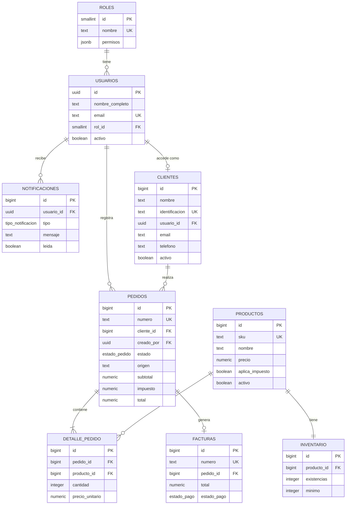

# SmartFlow ERP: Modelo de datos

| | |
|---|---|
| **Proyecto** | SmartFlow ERP |
| **Autora** | Maria Cristina Lopez (62151021), CEUTEC |
| **Versión** | 1.0 (borrador), noviembre de 2026 |
| **Elaboración** | Generado con asistencia de Claude; pendiente de revisión y de prueba en Supabase |
| **Motor** | PostgreSQL (Supabase) |
| **Relacionado con** | `01-requisitos.md` (RF-INV, RF-PED, RF-FAC, RNF-DAT) y `02-roles-permisos.md` |

---

## 1. Resumen

El modelo tiene **9 entidades**, las mismas de la ficha del proyecto, conectadas alrededor del pedido:

| # | Tabla | Propósito |
|---|---|---|
| 1 | `roles` | Roles del sistema y sus permisos |
| 2 | `usuarios` | Perfil de cada usuario (enlazado a Supabase Auth) |
| 3 | `clientes` | Clientes del negocio |
| 4 | `productos` | Catálogo con SKU y precio |
| 5 | `inventario` | Existencias y mínimo de cada producto (1:1) |
| 6 | `pedidos` | Encabezado del pedido, con estado y totales |
| 7 | `detalle_pedido` | Productos y cantidades de cada pedido |
| 8 | `facturas` | Factura emitida de un pedido (1:1) |
| 9 | `notificaciones` | Avisos para los usuarios |

**Flujo:** pedido → detalle → valida inventario → emite factura → notifica.

## 2. Diagrama entidad-relación



### Relaciones

| Relación | Cardinalidad | Regla |
|---|---|---|
| roles → usuarios | 1:N | Todo usuario tiene un rol |
| usuarios → pedidos | 1:N | Cada pedido guarda quién lo registró |
| usuarios → notificaciones | 1:N | Cada aviso es para un usuario |
| usuarios → clientes | 1:0..1 | Un cliente puede tener acceso al portal (usuario con rol `cliente`) |
| clientes → pedidos | 1:N | Todo pedido pertenece a un cliente |
| pedidos → detalle_pedido | 1:N | Un pedido tiene una o más líneas |
| productos → detalle_pedido | 1:N | Un producto aparece en muchas líneas |
| productos → inventario | 1:1 | Cada producto tiene un registro de inventario |
| pedidos → facturas | 1:1 | Un pedido tiene como máximo una factura |

---

## 3. Diccionario de datos

### 3.1 `roles`
| Campo | Tipo | Restricciones | Descripción |
|---|---|---|---|
| id | smallint | PK, identity | Identificador |
| nombre | text | UNIQUE, NOT NULL, solo 5 valores válidos | `administrador`, `vendedor`, `almacen`, `facturacion`, `cliente` |
| descripcion | text | | Descripción del rol |
| permisos | jsonb | NOT NULL | Lista de permisos (ver `02-roles-permisos.md`) |

### 3.2 `usuarios`
| Campo | Tipo | Restricciones | Descripción |
|---|---|---|---|
| id | uuid | PK, FK → `auth.users(id)` | Mismo id que Supabase Auth |
| nombre_completo | text | NOT NULL | Nombre del usuario |
| email | text | UNIQUE, NOT NULL | Correo |
| rol_id | smallint | FK → roles, NOT NULL | Rol asignado |
| activo | boolean | NOT NULL, por defecto true | Baja lógica |
| creado_en | timestamptz | por defecto now() | Fecha de creación |

### 3.3 `clientes`
| Campo | Tipo | Restricciones | Descripción |
|---|---|---|---|
| id | bigint | PK, identity | Identificador |
| nombre | text | NOT NULL | Nombre o razón social |
| identificacion | text | UNIQUE (admite nulo) | Documento de identidad o RTN |
| usuario_id | uuid | FK → usuarios, UNIQUE (admite nulo) | Acceso al portal; nulo si el cliente no tiene cuenta |
| email, telefono, direccion | text | | Datos de contacto |
| activo | boolean | NOT NULL, por defecto true | Baja lógica |
| creado_en, actualizado_en | timestamptz | | Auditoría básica |

### 3.4 `productos`
| Campo | Tipo | Restricciones | Descripción |
|---|---|---|---|
| id | bigint | PK, identity | Identificador |
| sku | text | UNIQUE, NOT NULL | Código del producto |
| nombre | text | NOT NULL | Nombre |
| descripcion | text | | Descripción |
| precio | numeric(12,2) | NOT NULL, ≥ 0 | Precio unitario en lempiras |
| aplica_impuesto | boolean | NOT NULL, por defecto true | Si genera impuesto |
| activo | boolean | NOT NULL, por defecto true | Baja lógica |
| creado_en, actualizado_en | timestamptz | | Auditoría básica |

### 3.5 `inventario`
| Campo | Tipo | Restricciones | Descripción |
|---|---|---|---|
| id | bigint | PK, identity | Identificador |
| producto_id | bigint | FK → productos, UNIQUE, NOT NULL | 1:1 con el producto |
| existencias | integer | NOT NULL, ≥ 0 | Unidades disponibles |
| minimo | integer | NOT NULL, ≥ 0 | Umbral de alerta |
| actualizado_en | timestamptz | | Última modificación |

### 3.6 `pedidos`
| Campo | Tipo | Restricciones | Descripción |
|---|---|---|---|
| id | bigint | PK, identity | Identificador |
| numero | text | UNIQUE, NOT NULL | Formato `PED-000001` (automático) |
| cliente_id | bigint | FK → clientes, NOT NULL | Cliente |
| creado_por | uuid | FK → usuarios, NOT NULL | Usuario que lo registró |
| estado | estado_pedido | NOT NULL, por defecto `pendiente` | pendiente, confirmado, facturado, entregado, cancelado |
| origen | text | NOT NULL, por defecto `interno` | `interno` (creado por el personal) o `portal` (creado por el cliente) |
| subtotal, impuesto, total | numeric(12,2) | NOT NULL, ≥ 0 | Se calculan al confirmar |
| tasa_impuesto | numeric(5,2) | | Tasa aplicada al confirmar |
| notas | text | | Observaciones |
| creado_en, actualizado_en | timestamptz | | Auditoría básica |

### 3.7 `detalle_pedido`
| Campo | Tipo | Restricciones | Descripción |
|---|---|---|---|
| id | bigint | PK, identity | Identificador |
| pedido_id | bigint | FK → pedidos (borrado en cascada), NOT NULL | Pedido |
| producto_id | bigint | FK → productos, NOT NULL | Producto |
| cantidad | integer | NOT NULL, > 0 | Unidades |
| precio_unitario | numeric(12,2) | NOT NULL, ≥ 0 | Precio congelado al agregar |
| subtotal | numeric(12,2) | Calculado: cantidad × precio_unitario | Total de la línea |
| | | UNIQUE (pedido_id, producto_id) | Un producto por línea |

### 3.8 `facturas`
| Campo | Tipo | Restricciones | Descripción |
|---|---|---|---|
| id | bigint | PK, identity | Identificador |
| numero | text | UNIQUE, NOT NULL | Formato `FAC-000001` (automático) |
| pedido_id | bigint | FK → pedidos, UNIQUE, NOT NULL | 1:1 con el pedido |
| emitida_por | uuid | FK → usuarios, NOT NULL | Quién la emitió |
| fecha_emision | timestamptz | por defecto now() | Fecha de emisión |
| subtotal, tasa_impuesto, impuesto, total | numeric | NOT NULL | Copia de los montos del pedido |
| estado_pago | estado_pago | por defecto `pendiente` | pendiente, pagada, anulada |
| metodo_pago | text | efectivo, transferencia o tarjeta | Método de pago |
| fecha_pago | timestamptz | Obligatoria si está pagada | Fecha de pago |

### 3.9 `notificaciones`
| Campo | Tipo | Restricciones | Descripción |
|---|---|---|---|
| id | bigint | PK, identity | Identificador |
| usuario_id | uuid | FK → usuarios (borrado en cascada) | Destinatario |
| tipo | tipo_notificacion | NOT NULL | stock_bajo, pedido_nuevo, factura_emitida, pago_recibido |
| mensaje | text | NOT NULL | Texto del aviso |
| leida | boolean | por defecto false | Estado de lectura |
| creada_en | timestamptz | por defecto now() | Fecha |

---

## 4. Reglas de negocio implementadas en la base de datos

| Regla | Dónde se aplica |
|---|---|
| Las existencias nunca son negativas | `CHECK (existencias >= 0)` |
| Un SKU no se repite | `UNIQUE (sku)` |
| Un producto aparece una sola vez por pedido | `UNIQUE (pedido_id, producto_id)` |
| Un pedido tiene como máximo una factura | `UNIQUE (pedido_id)` en `facturas` |
| Crear un producto crea su inventario | Trigger `trg_productos_inventario` |
| Confirmar valida, descuenta, calcula y notifica de forma atómica | Función `confirmar_pedido()` |
| Facturar solo si el pedido está confirmado | Función `emitir_factura()` |
| Cancelar un pedido confirmado restituye el inventario | Función `cancelar_pedido()` |
| Una factura pagada tiene fecha de pago | `CHECK` en `facturas` |
| Un pedido del portal nace pendiente y avisa al personal | Trigger `trg_pedidos_portal` |
| Un cliente solo ve sus propios pedidos y facturas, y nunca el inventario exacto | Políticas RLS |

---

## 5. Script SQL para Supabase

Ejecutar en **Supabase → SQL Editor** en este orden. El script se validó en PostgreSQL 16 simulando el esquema `auth` de Supabase: tablas, funciones, confirmación con descuento de inventario, rechazo por existencias insuficientes, facturación, cancelación con restitución y políticas RLS por rol. Aun así, ejecútalo primero en un proyecto vacío de Supabase.

### 5.1 Tipos, secuencias y funciones auxiliares

```sql
-- ============================================================
-- SmartFlow ERP: esquema inicial (Supabase / PostgreSQL)
-- ============================================================

-- Tipos enumerados
create type public.estado_pedido as enum
  ('pendiente', 'confirmado', 'facturado', 'entregado', 'cancelado');
create type public.estado_pago as enum
  ('pendiente', 'pagada', 'anulada');
create type public.tipo_notificacion as enum
  ('stock_bajo', 'pedido_nuevo', 'factura_emitida', 'pago_recibido');

-- Secuencias para la numeración automática
create sequence public.seq_pedidos  start 1;
create sequence public.seq_facturas start 1;

-- Mantiene actualizado el campo actualizado_en
create or replace function public.set_actualizado_en()
returns trigger
language plpgsql
as $$
begin
  new.actualizado_en = now();
  return new;
end;
$$;
```

### 5.2 Tablas

```sql
-- 1. Roles
create table public.roles (
  id          smallint generated always as identity primary key,
  nombre      text not null unique
              check (nombre in ('administrador', 'vendedor', 'almacen', 'facturacion', 'cliente')),
  descripcion text,
  permisos    jsonb not null default '[]'::jsonb
);

-- 2. Usuarios (perfil enlazado a Supabase Auth)
create table public.usuarios (
  id              uuid primary key references auth.users (id) on delete cascade,
  nombre_completo text not null,
  email           text not null unique,
  rol_id          smallint not null references public.roles (id),
  activo          boolean not null default true,
  creado_en       timestamptz not null default now()
);

-- 3. Clientes
create table public.clientes (
  id             bigint generated always as identity primary key,
  nombre         text not null,
  identificacion text unique,
  usuario_id     uuid unique references public.usuarios (id),
  email          text,
  telefono       text,
  direccion      text,
  activo         boolean not null default true,
  creado_en      timestamptz not null default now(),
  actualizado_en timestamptz not null default now()
);

-- 4. Productos
create table public.productos (
  id              bigint generated always as identity primary key,
  sku             text not null unique,
  nombre          text not null,
  descripcion     text,
  precio          numeric(12,2) not null check (precio >= 0),
  aplica_impuesto boolean not null default true,
  activo          boolean not null default true,
  creado_en       timestamptz not null default now(),
  actualizado_en  timestamptz not null default now()
);

-- 5. Inventario (1:1 con productos)
create table public.inventario (
  id             bigint generated always as identity primary key,
  producto_id    bigint not null unique
                 references public.productos (id) on delete cascade,
  existencias    integer not null default 0 check (existencias >= 0),
  minimo         integer not null default 0 check (minimo >= 0),
  actualizado_en timestamptz not null default now()
);

-- 6. Pedidos
create table public.pedidos (
  id             bigint generated always as identity primary key,
  numero         text not null unique
                 default ('PED-' || lpad(nextval('public.seq_pedidos')::text, 6, '0')),
  cliente_id     bigint not null references public.clientes (id),
  creado_por     uuid not null references public.usuarios (id),
  estado         public.estado_pedido not null default 'pendiente',
  subtotal       numeric(12,2) not null default 0 check (subtotal >= 0),
  impuesto       numeric(12,2) not null default 0 check (impuesto >= 0),
  total          numeric(12,2) not null default 0 check (total >= 0),
  tasa_impuesto  numeric(5,2),
  origen         text not null default 'interno' check (origen in ('interno', 'portal')),
  notas          text,
  creado_en      timestamptz not null default now(),
  actualizado_en timestamptz not null default now()
);

-- 7. Detalle del pedido
create table public.detalle_pedido (
  id              bigint generated always as identity primary key,
  pedido_id       bigint not null references public.pedidos (id) on delete cascade,
  producto_id     bigint not null references public.productos (id),
  cantidad        integer not null check (cantidad > 0),
  precio_unitario numeric(12,2) not null check (precio_unitario >= 0),
  subtotal        numeric(12,2) generated always as (cantidad * precio_unitario) stored,
  unique (pedido_id, producto_id)
);

-- 8. Facturas (1:1 con pedidos)
create table public.facturas (
  id            bigint generated always as identity primary key,
  numero        text not null unique
                default ('FAC-' || lpad(nextval('public.seq_facturas')::text, 6, '0')),
  pedido_id     bigint not null unique references public.pedidos (id),
  emitida_por   uuid not null references public.usuarios (id),
  fecha_emision timestamptz not null default now(),
  subtotal      numeric(12,2) not null,
  tasa_impuesto numeric(5,2)  not null,
  impuesto      numeric(12,2) not null,
  total         numeric(12,2) not null,
  estado_pago   public.estado_pago not null default 'pendiente',
  metodo_pago   text check (metodo_pago in ('efectivo', 'transferencia', 'tarjeta')),
  fecha_pago    timestamptz,
  check ((estado_pago = 'pagada') = (fecha_pago is not null))
);

-- 9. Notificaciones
create table public.notificaciones (
  id         bigint generated always as identity primary key,
  usuario_id uuid not null references public.usuarios (id) on delete cascade,
  tipo       public.tipo_notificacion not null,
  mensaje    text not null,
  leida      boolean not null default false,
  creada_en  timestamptz not null default now()
);
```

### 5.3 Índices y triggers

```sql
-- Índices (además de los que crean las claves primarias y UNIQUE)
create index idx_pedidos_cliente        on public.pedidos (cliente_id);
create index idx_pedidos_estado         on public.pedidos (estado);
create index idx_pedidos_creado_por     on public.pedidos (creado_por);
create index idx_pedidos_creado_en      on public.pedidos (creado_en desc);
create index idx_detalle_producto       on public.detalle_pedido (producto_id);
create index idx_notif_usuario_leida    on public.notificaciones (usuario_id, leida);
create index idx_facturas_fecha         on public.facturas (fecha_emision desc);
create index idx_usuarios_rol           on public.usuarios (rol_id);

-- Actualización automática de actualizado_en
create trigger trg_clientes_actualizado  before update on public.clientes
  for each row execute function public.set_actualizado_en();
create trigger trg_productos_actualizado before update on public.productos
  for each row execute function public.set_actualizado_en();
create trigger trg_inventario_actualizado before update on public.inventario
  for each row execute function public.set_actualizado_en();
create trigger trg_pedidos_actualizado   before update on public.pedidos
  for each row execute function public.set_actualizado_en();

-- Al crear un producto se crea su registro de inventario
create or replace function public.crear_inventario_producto()
returns trigger
language plpgsql
security definer
set search_path = public
as $$
begin
  insert into public.inventario (producto_id) values (new.id);
  return new;
end;
$$;

create trigger trg_productos_inventario after insert on public.productos
  for each row execute function public.crear_inventario_producto();

-- Un pedido creado desde el portal avisa a administradores y vendedores
create or replace function public.notificar_pedido_portal()
returns trigger
language plpgsql
security definer
set search_path = public
as $$
begin
  if new.origen = 'portal' then
    insert into public.notificaciones (usuario_id, tipo, mensaje)
    select u.id, 'pedido_nuevo',
           format('Nuevo pedido del portal %s pendiente de confirmar', new.numero)
      from public.usuarios u
      join public.roles r on r.id = u.rol_id
     where u.activo and r.nombre in ('administrador', 'vendedor');
  end if;
  return new;
end;
$$;

create trigger trg_pedidos_portal after insert on public.pedidos
  for each row execute function public.notificar_pedido_portal();
```

### 5.4 Lógica de negocio: confirmar, facturar y cancelar

La API llama a estas funciones con la clave `service_role`. Cada función se ejecuta como **una sola transacción**: si algo falla, no queda ningún cambio parcial (RNF-FIA-01).

```sql
-- Confirmar pedido: valida existencias, descuenta inventario, calcula totales y notifica
create or replace function public.confirmar_pedido(
  p_pedido_id bigint,
  p_tasa      numeric default 15.00
)
returns public.pedidos
language plpgsql
as $$
declare
  v_pedido   public.pedidos;
  v_item     record;
  v_subtotal numeric(12,2);
  v_impuesto numeric(12,2);
begin
  select * into v_pedido
  from public.pedidos where id = p_pedido_id for update;

  if not found then
    raise exception 'El pedido % no existe', p_pedido_id;
  end if;
  if v_pedido.estado <> 'pendiente' then
    raise exception 'Solo se puede confirmar un pedido pendiente (estado actual: %)', v_pedido.estado;
  end if;
  if not exists (select 1 from public.detalle_pedido where pedido_id = p_pedido_id) then
    raise exception 'El pedido no tiene productos';
  end if;

  -- Valida existencias y bloquea las filas de inventario involucradas
  for v_item in
    select d.cantidad, i.existencias, p.nombre
    from public.detalle_pedido d
    join public.inventario i on i.producto_id = d.producto_id
    join public.productos  p on p.id = d.producto_id
    where d.pedido_id = p_pedido_id
    order by d.producto_id
    for update of i
  loop
    if v_item.existencias < v_item.cantidad then
      raise exception 'Existencias insuficientes de "%": disponibles %, solicitadas %',
        v_item.nombre, v_item.existencias, v_item.cantidad;
    end if;
  end loop;

  -- Descuenta el inventario
  update public.inventario i
     set existencias = i.existencias - d.cantidad
    from public.detalle_pedido d
   where d.pedido_id = p_pedido_id
     and i.producto_id = d.producto_id;

  -- Calcula los totales
  select coalesce(sum(d.cantidad * d.precio_unitario), 0),
         coalesce(sum(case when p.aplica_impuesto
                           then d.cantidad * d.precio_unitario * p_tasa / 100
                           else 0 end), 0)
    into v_subtotal, v_impuesto
    from public.detalle_pedido d
    join public.productos p on p.id = d.producto_id
   where d.pedido_id = p_pedido_id;

  update public.pedidos
     set estado        = 'confirmado',
         subtotal      = v_subtotal,
         impuesto      = round(v_impuesto, 2),
         total         = v_subtotal + round(v_impuesto, 2),
         tasa_impuesto = p_tasa
   where id = p_pedido_id
   returning * into v_pedido;

  -- Notifica a almacén y facturación que hay un pedido confirmado
  insert into public.notificaciones (usuario_id, tipo, mensaje)
  select u.id, 'pedido_nuevo', format('Pedido %s confirmado', v_pedido.numero)
    from public.usuarios u
    join public.roles r on r.id = u.rol_id
   where u.activo and r.nombre in ('almacen', 'facturacion');

  -- Notifica stock bajo a administradores y almacén
  insert into public.notificaciones (usuario_id, tipo, mensaje)
  select u.id, 'stock_bajo',
         format('Stock bajo: %s (quedan %s, mínimo %s)', p.nombre, i.existencias, i.minimo)
    from public.detalle_pedido d
    join public.inventario i on i.producto_id = d.producto_id
    join public.productos  p on p.id = d.producto_id
    join public.usuarios   u on u.activo
    join public.roles      r on r.id = u.rol_id and r.nombre in ('administrador', 'almacen')
   where d.pedido_id = p_pedido_id
     and i.existencias <= i.minimo;

  return v_pedido;
end;
$$;

-- Emitir factura de un pedido confirmado
create or replace function public.emitir_factura(
  p_pedido_id   bigint,
  p_emitida_por uuid
)
returns public.facturas
language plpgsql
as $$
declare
  v_pedido  public.pedidos;
  v_factura public.facturas;
begin
  select * into v_pedido
  from public.pedidos where id = p_pedido_id for update;

  if not found then
    raise exception 'El pedido % no existe', p_pedido_id;
  end if;
  if v_pedido.estado <> 'confirmado' then
    raise exception 'Solo se puede facturar un pedido confirmado (estado actual: %)', v_pedido.estado;
  end if;

  insert into public.facturas
    (pedido_id, emitida_por, subtotal, tasa_impuesto, impuesto, total)
  values
    (v_pedido.id, p_emitida_por, v_pedido.subtotal, v_pedido.tasa_impuesto,
     v_pedido.impuesto, v_pedido.total)
  returning * into v_factura;

  update public.pedidos set estado = 'facturado' where id = v_pedido.id;

  insert into public.notificaciones (usuario_id, tipo, mensaje)
  values (v_pedido.creado_por, 'factura_emitida',
          format('Factura %s emitida para el pedido %s', v_factura.numero, v_pedido.numero));

  return v_factura;
end;
$$;

-- Cancelar pedido (restituye inventario si estaba confirmado)
create or replace function public.cancelar_pedido(p_pedido_id bigint)
returns public.pedidos
language plpgsql
as $$
declare
  v_pedido public.pedidos;
begin
  select * into v_pedido
  from public.pedidos where id = p_pedido_id for update;

  if not found then
    raise exception 'El pedido % no existe', p_pedido_id;
  end if;
  if v_pedido.estado not in ('pendiente', 'confirmado') then
    raise exception 'No se puede cancelar un pedido en estado %', v_pedido.estado;
  end if;

  if v_pedido.estado = 'confirmado' then
    update public.inventario i
       set existencias = i.existencias + d.cantidad
      from public.detalle_pedido d
     where d.pedido_id = p_pedido_id
       and i.producto_id = d.producto_id;
  end if;

  update public.pedidos set estado = 'cancelado'
   where id = p_pedido_id
   returning * into v_pedido;

  return v_pedido;
end;
$$;

-- Solo el backend (service_role) puede ejecutar estas funciones
revoke execute on function public.confirmar_pedido(bigint, numeric) from public, anon, authenticated;
revoke execute on function public.emitir_factura(bigint, uuid)       from public, anon, authenticated;
revoke execute on function public.cancelar_pedido(bigint)            from public, anon, authenticated;
```

### 5.5 Row Level Security (RLS)

```sql
-- Funciones auxiliares (security definer para evitar recursión de RLS)
create or replace function public.rol_actual()
returns text
language sql
stable
security definer
set search_path = public
as $$
  select r.nombre
    from public.usuarios u
    join public.roles r on r.id = u.rol_id
   where u.id = auth.uid() and u.activo;
$$;

-- true si el usuario es del personal (no es cliente del portal)
create or replace function public.es_personal()
returns boolean
language sql
stable
security definer
set search_path = public
as $$
  select coalesce(public.rol_actual() in ('administrador', 'vendedor', 'almacen', 'facturacion'), false);
$$;

-- Activar RLS en las 9 tablas
alter table public.roles          enable row level security;
alter table public.usuarios       enable row level security;
alter table public.clientes       enable row level security;
alter table public.productos      enable row level security;
alter table public.inventario     enable row level security;
alter table public.pedidos        enable row level security;
alter table public.detalle_pedido enable row level security;
alter table public.facturas       enable row level security;
alter table public.notificaciones enable row level security;

-- roles
create policy roles_select on public.roles for select to authenticated
  using (public.es_personal());
create policy roles_admin on public.roles for all to authenticated
  using (public.rol_actual() = 'administrador')
  with check (public.rol_actual() = 'administrador');

-- usuarios
create policy usuarios_select on public.usuarios for select to authenticated
  using (id = auth.uid() or public.rol_actual() = 'administrador');
create policy usuarios_admin on public.usuarios for all to authenticated
  using (public.rol_actual() = 'administrador')
  with check (public.rol_actual() = 'administrador');

-- clientes: el personal ve todos; un cliente del portal solo su propio registro
create policy clientes_select on public.clientes for select to authenticated
  using (public.es_personal() or usuario_id = auth.uid());
create policy clientes_insert on public.clientes for insert to authenticated
  with check (public.rol_actual() in ('administrador', 'vendedor'));
create policy clientes_update on public.clientes for update to authenticated
  using (public.rol_actual() in ('administrador', 'vendedor'))
  with check (public.rol_actual() in ('administrador', 'vendedor'));
create policy clientes_delete on public.clientes for delete to authenticated
  using (public.rol_actual() = 'administrador');

-- productos: el cliente solo ve los activos
create policy productos_select on public.productos for select to authenticated
  using (public.es_personal() or (public.rol_actual() = 'cliente' and activo));
create policy productos_insert on public.productos for insert to authenticated
  with check (public.rol_actual() in ('administrador', 'almacen'));
create policy productos_update on public.productos for update to authenticated
  using (public.rol_actual() in ('administrador', 'almacen'))
  with check (public.rol_actual() in ('administrador', 'almacen'));
create policy productos_delete on public.productos for delete to authenticated
  using (public.rol_actual() = 'administrador');

-- inventario: el cliente no ve las existencias (la API le muestra solo disponible o agotado)
create policy inventario_select on public.inventario for select to authenticated
  using (public.es_personal());
create policy inventario_write on public.inventario for all to authenticated
  using (public.rol_actual() in ('administrador', 'almacen'))
  with check (public.rol_actual() in ('administrador', 'almacen'));

-- pedidos: el vendedor ve los suyos y los del portal; el cliente solo los suyos
create policy pedidos_select on public.pedidos for select to authenticated
  using (
    public.rol_actual() in ('administrador', 'almacen', 'facturacion')
    or (public.rol_actual() = 'vendedor' and (creado_por = auth.uid() or origen = 'portal'))
    or (public.rol_actual() = 'cliente'
        and cliente_id in (select c.id from public.clientes c where c.usuario_id = auth.uid()))
  );
create policy pedidos_insert on public.pedidos for insert to authenticated
  with check (
    (public.rol_actual() in ('administrador', 'vendedor')
       and creado_por = auth.uid() and origen = 'interno')
    or (public.rol_actual() = 'cliente'
        and creado_por = auth.uid() and origen = 'portal'
        and cliente_id in (select c.id from public.clientes c where c.usuario_id = auth.uid()))
  );
create policy pedidos_update on public.pedidos for update to authenticated
  using (
    public.rol_actual() in ('administrador', 'almacen')
    or (public.rol_actual() = 'vendedor' and (creado_por = auth.uid() or origen = 'portal'))
  );

-- detalle_pedido: hereda la visibilidad del pedido; solo se edita si está pendiente
create policy detalle_select on public.detalle_pedido for select to authenticated
  using (exists (select 1 from public.pedidos p where p.id = pedido_id));
create policy detalle_write on public.detalle_pedido for all to authenticated
  using (exists (
    select 1 from public.pedidos p
     where p.id = pedido_id and p.estado = 'pendiente'
       and (public.rol_actual() = 'administrador' or p.creado_por = auth.uid())
  ))
  with check (exists (
    select 1 from public.pedidos p
     where p.id = pedido_id and p.estado = 'pendiente'
       and (public.rol_actual() = 'administrador' or p.creado_por = auth.uid())
  ));

-- facturas: quien puede ver el pedido (vendedor o cliente) puede ver su factura
create policy facturas_select on public.facturas for select to authenticated
  using (
    public.rol_actual() in ('administrador', 'facturacion')
    or (public.rol_actual() in ('vendedor', 'cliente') and exists (
         select 1 from public.pedidos p where p.id = pedido_id))
  );
create policy facturas_write on public.facturas for all to authenticated
  using (public.rol_actual() in ('administrador', 'facturacion'))
  with check (public.rol_actual() in ('administrador', 'facturacion'));

-- notificaciones: cada usuario ve y marca solo las suyas
create policy notif_select on public.notificaciones for select to authenticated
  using (usuario_id = auth.uid());
create policy notif_update on public.notificaciones for update to authenticated
  using (usuario_id = auth.uid())
  with check (usuario_id = auth.uid());
```

> La clave `service_role` que usa el backend **no pasa por RLS**. Por eso la autorización en Express (`02-roles-permisos.md`) es obligatoria. RLS protege cualquier acceso directo con la clave `anon` o con el token de un usuario.

### 5.6 Datos iniciales

```sql
-- Roles (permisos resumidos; ver 02-roles-permisos.md)
insert into public.roles (nombre, descripcion, permisos) values
  ('administrador', 'Control total del sistema', '["*"]'),
  ('vendedor',      'Gestiona clientes y pedidos propios',
   '["clientes:crear","clientes:editar","clientes:ver","productos:ver","inventario:ver","pedidos:crear","pedidos:ver_propios","pedidos:editar_propios","pedidos:confirmar_propios","pedidos:cancelar_propios","pedidos:ver_portal","pedidos:confirmar_portal","pedidos:cancelar_portal","facturas:ver_propias"]'),
  ('almacen',       'Gestiona productos, existencias y entregas',
   '["clientes:ver","productos:ver","productos:crear","productos:editar","inventario:ver","inventario:entrada","inventario:ajustar","pedidos:ver","pedidos:entregar","reportes:inventario"]'),
  ('facturacion',   'Emite facturas y registra pagos',
   '["clientes:ver","productos:ver","inventario:ver","pedidos:ver","facturas:emitir","facturas:ver","facturas:pago","reportes:ventas"]'),
  ('cliente',       'Cliente con acceso al portal',
   '["catalogo:ver","portal_pedidos:crear","portal_pedidos:ver_propios","portal_pedidos:cancelar_propios","facturas:ver_propias","notificaciones:ver"]');

-- Datos de prueba (productos y clientes de ejemplo)
insert into public.productos (sku, nombre, precio) values
  ('SKU-001', 'Camisa polo',     250.00),
  ('SKU-002', 'Pantalón jeans',  420.00),
  ('SKU-003', 'Gorra deportiva', 120.00);

update public.inventario set existencias = 50, minimo = 10;

insert into public.clientes (nombre, identificacion, email, telefono) values
  ('Comercial Los Pinos', '0501-1990-00001', 'ventas@lospinos.example', '9999-0001'),
  ('María Fernández',     '0501-1995-00002', 'maria@example.com',       '9999-0002');
```

**Primer usuario administrador:** crea el usuario en **Supabase → Authentication → Users → Add user**, copia su UUID y ejecuta:

```sql
insert into public.usuarios (id, nombre_completo, email, rol_id)
values ('<UUID-DEL-USUARIO>', 'Administrador', 'admin@tu-correo.com',
        (select id from public.roles where nombre = 'administrador'));
```

### 5.7 Prueba rápida de la lógica

```sql
-- 1) Crear un pedido de prueba (reemplaza el UUID por el de tu administrador)
insert into public.pedidos (cliente_id, creado_por)
values (1, '<UUID-DEL-USUARIO>');

insert into public.detalle_pedido (pedido_id, producto_id, cantidad, precio_unitario)
select 1, id, 2, precio from public.productos where sku = 'SKU-001';

-- 2) Confirmar y revisar el descuento de inventario
select * from public.confirmar_pedido(1);
select p.sku, i.existencias from public.inventario i join public.productos p on p.id = i.producto_id;

-- 3) Facturar
select * from public.emitir_factura(1, '<UUID-DEL-USUARIO>');

-- 4) Probar el rechazo por existencias insuficientes
--    (crea otro pedido con cantidad 999 y ejecuta confirmar_pedido: debe fallar sin cambiar nada)
```

---

## 6. Decisiones de diseño

| Decisión | Motivo | Alternativa descartada |
|---|---|---|
| Se conservan las **9 entidades** de la ficha | Coherencia con el alcance aprobado | Agregar tablas de movimientos y configuración (más complejo para 8 semanas) |
| `usuarios` enlaza con `auth.users` | Supabase Auth maneja contraseñas y sesiones; la tabla solo guarda el perfil y el rol | Tabla propia de credenciales (menos segura) |
| Confirmar, facturar y cancelar como **funciones SQL transaccionales** | Garantiza que no queden cambios parciales y evita errores de concurrencia (bloqueo con `FOR UPDATE`) | Varias llamadas separadas desde Node (riesgo de inconsistencias) |
| `precio_unitario` copiado en el detalle | El precio del pedido no cambia si luego se edita el producto | Leer siempre el precio actual |
| Totales guardados en `pedidos` y copiados a `facturas` | La factura emitida no cambia aunque cambien los datos | Recalcular en cada consulta |
| Bajas lógicas (`activo`) | Se conserva el historial | Borrado físico |
| Impuesto como **parámetro** (`p_tasa`) | No exige modificar el código si cambia la tasa | Tasa fija en el código |
| El cliente del portal es un `usuario` con rol `cliente`, enlazado a su registro en `clientes` (`usuario_id`) | Reutiliza Auth, roles y RLS sin agregar una décima tabla | Tabla aparte de cuentas de cliente |
| Un pedido del portal nace `pendiente` y no descuenta inventario hasta que el personal lo confirma | Evita que pedidos no verificados reserven existencias | Confirmación automática |

## 7. Limitaciones y mejoras futuras

- **Impuesto por producto:** hoy un producto aplica el 15 % o está exento. El ISV tiene también una tasa del 18 % para ciertos bienes (por ejemplo, alcohol y tabaco). Para venderlos habría que guardar la tasa en cada producto y desglosar el impuesto por tasa en la factura.
- **Historial de movimientos de inventario** (RF-INV-09): tabla `inventario_movimientos` con tipo, cantidad, motivo y usuario. Es la mejora más recomendable si sobra tiempo.
- **Numeración de facturas:** las secuencias de PostgreSQL pueden dejar saltos si una transacción falla. Es suficiente para un comprobante interno; una factura fiscal oficial exige numeración sin saltos y está fuera del alcance.
- **Configuración del negocio** (nombre, RTN, tasa de impuesto, logo): hoy la tasa se envía desde una variable de entorno del backend.
- **Multiempresa (SaaS):** requeriría agregar `empresa_id` a todas las tablas y ajustar las políticas RLS.
- **Pagos parciales:** se maneja un solo pago por factura.
