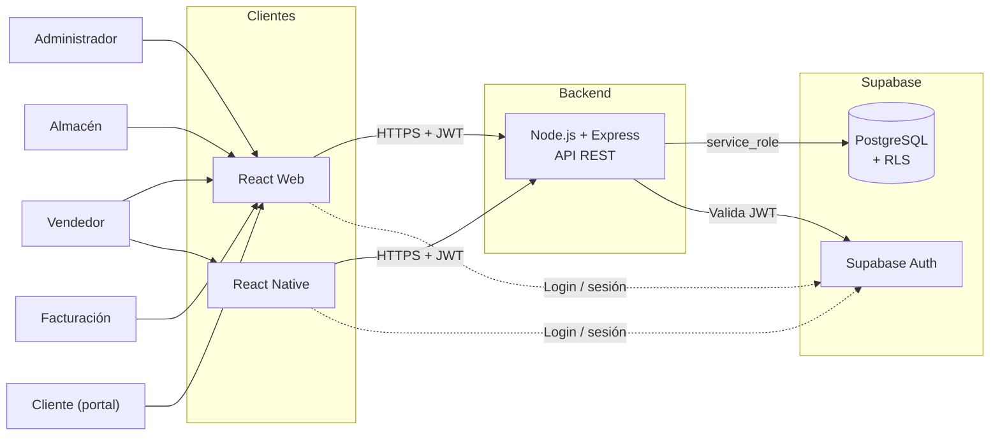
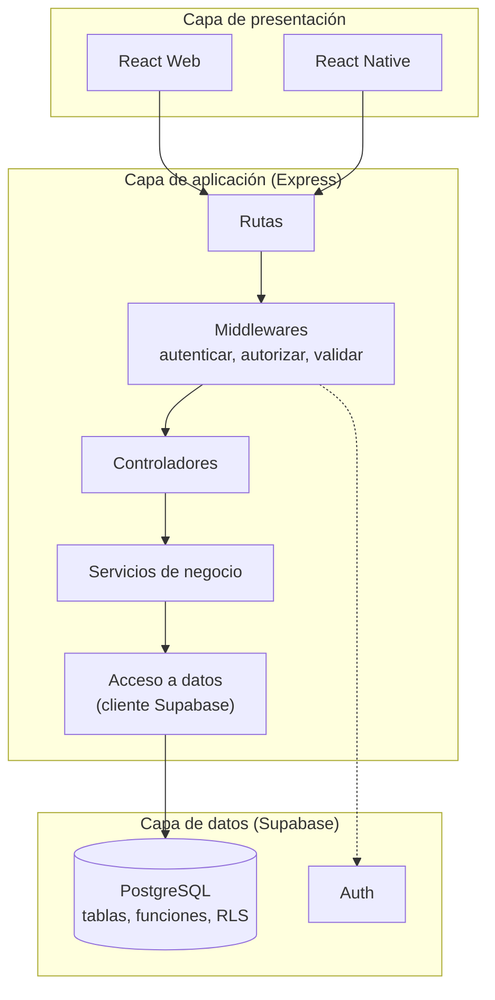
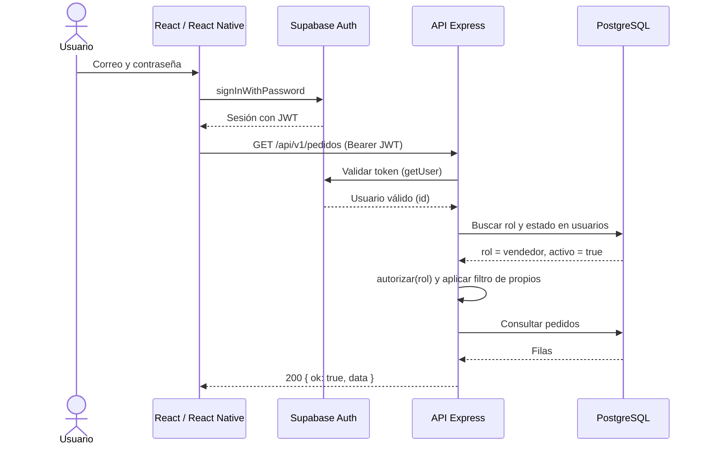
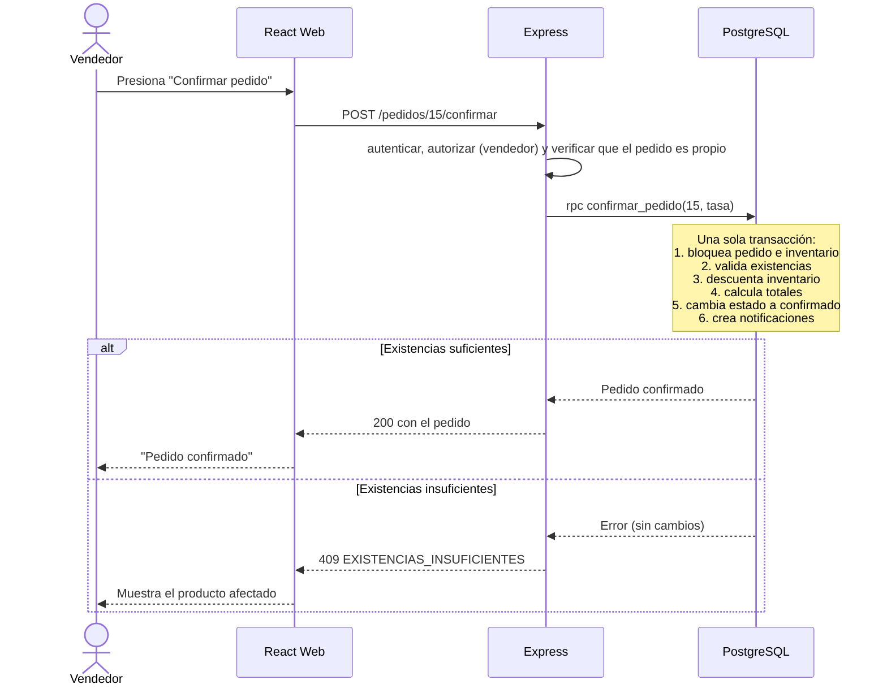
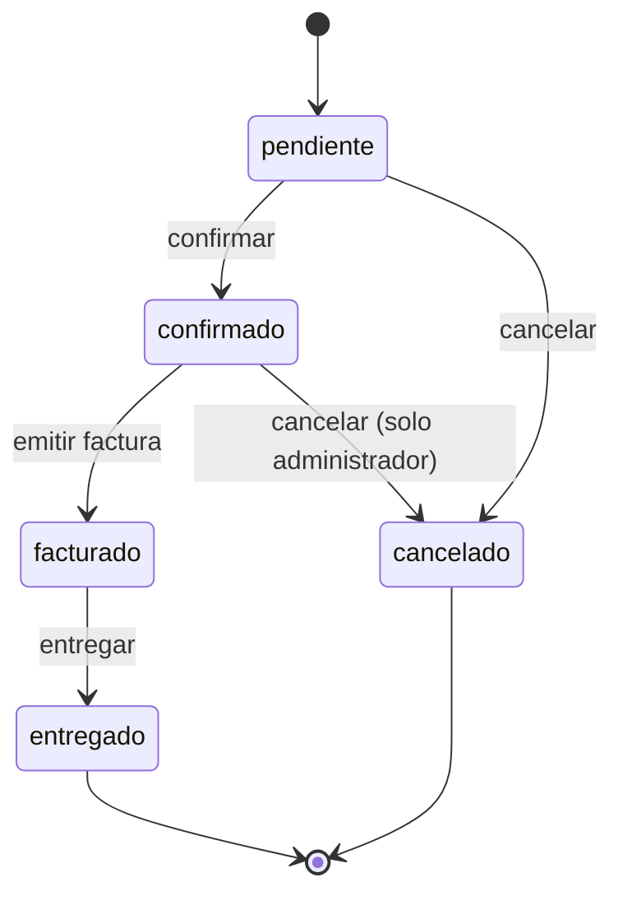

# SmartFlow ERP: Arquitectura del sistema

| | |
|---|---|
| **Proyecto** | SmartFlow ERP |
| **Autora** | Maria Cristina Lopez (62151021), CEUTEC |
| **Versión** | 1.0 (borrador), noviembre de 2026 |
| **Elaboración** | Generado con asistencia de Claude; pendiente de revisión de la autora |
| **Relacionado con** | `01-requisitos.md` (RNF), `02-roles-permisos.md`, `04-modelo-datos.md` |

---

## 1. Visión general

SmartFlow sigue una **arquitectura por capas con frontend y backend desacoplados**, comunicados por una **API REST** (JSON sobre HTTPS). Los clientes (web y móvil) nunca acceden directamente a las tablas de negocio: toda operación pasa por la API, que aplica las reglas de negocio y los permisos.

**Principios de diseño**

1. **Separación de responsabilidades:** la interfaz muestra, la API decide, la base de datos guarda.
2. **El servidor es la autoridad:** los permisos y validaciones se aplican siempre en el backend.
3. **Un solo backend para dos clientes:** web y móvil consumen exactamente la misma API.
4. **Simplicidad:** el stack es mínimo y realizable por una persona en unas 8 semanas (RNF-DES-01).
5. **Seguridad en capas:** JWT, autorización por rol en Express y RLS en la base de datos.

### Stack tecnológico

| Capa | Tecnología | Función |
|---|---|---|
| Frontend web | React | Panel administrativo |
| App móvil | React Native | Pedidos y consultas desde el teléfono |
| Backend | Node.js + Express | API REST con la lógica de negocio |
| Datos y autenticación | Supabase (PostgreSQL + Auth) | Persistencia, usuarios y sesiones |
| Control de versiones | Git y GitHub | Ramas por módulo e historial |
| Gestión del proyecto | Trello (Kanban) | Seguimiento de tareas |

---

## 2. Vista de contexto



## 3. Arquitectura en capas



| Capa | Responsabilidad | No debe hacer |
|---|---|---|
| **Rutas** | Definir los endpoints y encadenar middlewares | Contener lógica de negocio |
| **Middlewares** | Autenticar, autorizar, validar entradas, manejar errores | Acceder a la base de datos |
| **Controladores** | Leer la petición, llamar al servicio y armar la respuesta HTTP | Calcular reglas de negocio |
| **Servicios** | Reglas de negocio (por ejemplo, filtros por vendedor, PDF de facturas) | Conocer detalles de HTTP |
| **Acceso a datos** | Consultas a Supabase y llamadas a funciones SQL (`rpc`) | Decidir permisos |

---

## 4. Estructura del repositorio

```
smartflow-system/
├── backend/
│   ├── src/
│   │   ├── config/            # variables de entorno y cliente de Supabase
│   │   ├── middlewares/       # autenticar.js, autorizar.js, validar.js, errores.js
│   │   ├── routes/            # una carpeta o archivo por módulo
│   │   ├── controllers/
│   │   ├── services/
│   │   ├── utils/             # respuestas estándar, generación de PDF
│   │   ├── app.js             # configuración de Express
│   │   └── server.js          # arranque del servidor
│   ├── tests/
│   ├── .env.example
│   └── package.json
├── web/                       # React
│   └── src/ (pages, components, portal, services/api, hooks, auth)
├── mobile/                    # React Native
│   └── src/ (screens, components, services/api, navigation, auth)
├── docs/                      # estos 5 documentos
├── .gitignore
└── README.md
```

---

## 5. API REST

**Base:** `/api/v1` · **Formato:** JSON · **Autenticación:** cabecera `Authorization: Bearer <token>`

### 5.1 Convenciones

- Nombres de recursos en plural y en español: `/clientes`, `/pedidos`.
- Métodos: `GET` consulta, `POST` crea o ejecuta acciones, `PATCH` modifica parcialmente, `DELETE` hace baja lógica.
- Listados con paginación: `?pagina=1&limite=50` (máximo 50) y filtros por query string.
- Códigos HTTP: 200, 201, 400 (datos inválidos), 401 (sin sesión), 403 (sin permiso), 404, 409 (conflicto, por ejemplo SKU duplicado) y 500.

**Respuesta exitosa**
```json
{ "ok": true, "data": { }, "meta": { "pagina": 1, "limite": 50, "total": 120 } }
```

**Respuesta de error**
```json
{ "ok": false, "error": { "codigo": "EXISTENCIAS_INSUFICIENTES", "mensaje": "Existencias insuficientes de \"Camisa polo\"." } }
```

### 5.2 Endpoints por módulo

**Roles:** A = administrador, V = vendedor, AL = almacén, F = facturación, C = cliente del portal. **Todos** = cualquier usuario del personal (A, V, AL, F). El cliente solo usa los endpoints marcados con C, `/me` y `/notificaciones`.

| Módulo | Método y ruta | Descripción | Roles |
|---|---|---|---|
| Sesión | `GET /me` | Perfil y rol del usuario actual | Todos y C |
| Usuarios | `GET /usuarios` | Listar usuarios | A |
| | `POST /usuarios` | Crear usuario (Auth + perfil) | A |
| | `PATCH /usuarios/:id` | Editar nombre o rol | A |
| | `PATCH /usuarios/:id/estado` | Activar o desactivar | A |
| Roles | `GET /roles` | Roles y permisos | A |
| Clientes | `GET /clientes` | Listar y buscar | Todos |
| | `POST /clientes` | Crear | A, V |
| | `GET /clientes/:id` | Detalle con historial de pedidos | Todos |
| | `PATCH /clientes/:id` | Editar | A, V |
| | `DELETE /clientes/:id` | Baja lógica | A |
| | `POST /clientes/:id/acceso` | Crear el usuario (rol cliente) de un cliente | A, V |
| Productos | `GET /productos` | Listar y buscar (incluye existencias) | Todos |
| | `POST /productos` | Crear (crea su inventario) | A, AL |
| | `PATCH /productos/:id` | Editar | A, AL |
| | `DELETE /productos/:id` | Baja lógica | A |
| Inventario | `GET /inventario` | Existencias de todos los productos | Todos |
| | `GET /inventario/bajo-minimo` | Productos en o bajo el mínimo | A, V, AL |
| | `PATCH /inventario/:productoId/minimo` | Definir mínimo | A, AL |
| | `POST /inventario/:productoId/entradas` | Registrar entrada | A, AL |
| | `POST /inventario/:productoId/ajustes` | Ajuste manual | A, AL |
| Pedidos | `GET /pedidos` | Listar con filtros (vendedor: propios y del portal) | A, V, AL, F |
| | `POST /pedidos` | Crear pedido con detalle | A, V |
| | `GET /pedidos/:id` | Detalle | A, V (propio), AL, F |
| | `PUT /pedidos/:id/detalle` | Reemplazar líneas (solo pendiente) | A, V (propio) |
| | `POST /pedidos/:id/confirmar` | Valida inventario y confirma | A, V (propio o del portal) |
| | `POST /pedidos/:id/cancelar` | Cancela (confirmado: solo A) | A, V (propio pendiente) |
| | `POST /pedidos/:id/entregar` | Marca como entregado | A, AL |
| Facturas | `POST /pedidos/:id/factura` | Emitir factura | A, F |
| | `GET /facturas` | Listar | A, F, V (propias) |
| | `GET /facturas/:id` | Detalle | A, F, V (propia) |
| | `GET /facturas/:id/pdf` | Descargar PDF | A, F, V (propia) |
| | `POST /facturas/:id/pago` | Registrar pago | A, F |
| Reportes | `GET /reportes/dashboard` | Indicadores según el rol | Todos |
| | `GET /reportes/ventas?desde=&hasta=` | Ventas por periodo y más vendidos | A, F |
| | `GET /reportes/inventario` | Inventario valorizado | A, AL |
| Notificaciones | `GET /notificaciones` | Listar las propias | Todos y C |
| | `PATCH /notificaciones/:id/leida` | Marcar como leída | Todos y C |
| Portal del cliente | `GET /portal/catalogo` | Productos activos con precio y disponibilidad (sin cantidades) | C |
| | `POST /portal/pedidos` | Crear pedido propio (nace pendiente) | C |
| | `GET /portal/pedidos` | Mis pedidos | C |
| | `GET /portal/pedidos/:id` | Detalle de mi pedido | C |
| | `POST /portal/pedidos/:id/cancelar` | Cancelar mi pedido pendiente | C |
| | `GET /portal/facturas` | Mis facturas | C |
| | `GET /portal/facturas/:id/pdf` | Descargar mi factura | C |

### 5.3 Ejemplo: crear un pedido

```http
POST /api/v1/pedidos
Authorization: Bearer <token>
Content-Type: application/json

{
  "cliente_id": 1,
  "notas": "Entrega por la tarde",
  "items": [
    { "producto_id": 1, "cantidad": 2 },
    { "producto_id": 3, "cantidad": 1 }
  ]
}
```

El servidor lee el precio actual de cada producto y lo guarda en `precio_unitario` (el cliente **no** envía precios). El pedido nace en estado `pendiente`.

---

## 6. Autenticación y autorización

### 6.1 Decisión: el cliente inicia sesión con Supabase Auth

Los clientes (web y móvil) usan el SDK de Supabase solo para **iniciar y cerrar sesión, renovar el token y recuperar la contraseña**. Con el token (JWT) obtenido llaman a la API de SmartFlow. La API **valida el token** y consulta el rol del usuario en la tabla `usuarios`.



### 6.2 Middleware de autenticación

```javascript
// backend/src/middlewares/autenticar.js
import { supabaseAdmin } from '../config/supabase.js';

export const autenticar = async (req, res, next) => {
  const token = req.headers.authorization?.replace('Bearer ', '');
  if (!token) {
    return res.status(401).json({ ok: false, error: { codigo: 'NO_AUTENTICADO', mensaje: 'Falta el token.' } });
  }

  const { data, error } = await supabaseAdmin.auth.getUser(token);
  if (error || !data?.user) {
    return res.status(401).json({ ok: false, error: { codigo: 'TOKEN_INVALIDO', mensaje: 'Sesión inválida o vencida.' } });
  }

  const { data: perfil } = await supabaseAdmin
    .from('usuarios')
    .select('id, nombre_completo, activo, roles(nombre)')
    .eq('id', data.user.id)
    .single();

  if (!perfil || !perfil.activo) {
    return res.status(403).json({ ok: false, error: { codigo: 'USUARIO_INACTIVO', mensaje: 'Usuario sin acceso.' } });
  }

  req.usuario = { id: perfil.id, nombre: perfil.nombre_completo, rol: perfil.roles.nombre };
  next();
};
```

El middleware `autorizar(...roles)` está en `02-roles-permisos.md`.

### 6.3 Portal del cliente

El portal es parte de la misma aplicación web, con rutas y endpoints separados por rol:

- Los endpoints `/portal/*` usan `autenticar` y `autorizar('cliente')`.
- Al autenticar a un cliente, `req.usuario` incluye su `cliente_id` (se busca en `clientes.usuario_id`). El servicio usa **siempre** ese valor y nunca uno enviado por el cliente.
- El catálogo del portal devuelve solo `disponible: true/false`, no las existencias.
- `POST /portal/pedidos` crea el pedido con `origen = 'portal'` y estado `pendiente`; los precios los lee el servidor. **No** llama a `confirmar_pedido`: la confirmación la hace el personal.
- Un trigger de la base de datos avisa a administradores y vendedores de cada pedido nuevo del portal.

---

## 7. Flujo principal: confirmar un pedido



**Ciclo completo del pedido:** cliente → pedido → detalle → validación de inventario → factura → pago → dashboard.



---

## 8. Manejo de errores y validación

- **Validación de entradas** en un middleware (por ejemplo, con la librería Zod): tipos, rangos y campos obligatorios. Si algo falla, responde 400 con el detalle.
- **Errores de negocio de la base de datos** (por ejemplo, existencias insuficientes) se traducen a códigos propios (`EXISTENCIAS_INSUFICIENTES`, `ESTADO_INVALIDO`) con estado 409.
- **Un middleware global de errores** captura lo inesperado, registra el detalle en el servidor y devuelve al cliente un mensaje genérico (RNF-SEG-06).
- Nunca se devuelven trazas ni consultas SQL al cliente.

## 9. Configuración y secretos

`backend/.env.example` (se sube al repositorio, **sin valores reales**):

```
PORT=3000
NODE_ENV=development
SUPABASE_URL=https://TU-PROYECTO.supabase.co
SUPABASE_SERVICE_ROLE_KEY=
TASA_IMPUESTO=15.00
CORS_ORIGIN=http://localhost:5173
```

| Variable | Dónde vive | Nota |
|---|---|---|
| `SUPABASE_SERVICE_ROLE_KEY` | **Solo backend** | Equivale a acceso total a la base de datos: nunca va al repositorio, a la web ni al móvil |
| `SUPABASE_URL` y clave `anon` | Web y móvil | Son públicas por diseño; la protección real es RLS y la API |
| `TASA_IMPUESTO` | Backend | Se pasa a `confirmar_pedido` (RF-FAC-04) |

El archivo `.env` real está en `.gitignore`.

---

## 10. Despliegue propuesto

| Componente | Opción sugerida | Nota |
|---|---|---|
| Base de datos y Auth | Supabase (plan gratuito) | Verificar límites vigentes antes de la demostración |
| API Express | Un servicio de alojamiento de Node.js (por ejemplo, Render o Railway) | Variables de entorno configuradas en el panel del proveedor |
| Web React | Hosting estático (por ejemplo, Vercel o Netlify) | Configurar la URL de la API |
| App móvil | Expo Go o emulador para la demostración | Publicar en tiendas queda fuera del alcance |

Para la presentación, también basta con ejecutar todo en local (`localhost`) conectado a Supabase en la nube.

## 11. Flujo de trabajo con Git y calidad

- **Ramas:** `main` (estable) · `develop` (integración) · `feature/<módulo>` (por ejemplo, `feature/backend-clientes`, `feature/web-pedidos`).
- **Commits descriptivos** con prefijo: `feat:`, `fix:`, `docs:`, `chore:`, `test:`.
- **Integración:** una rama `feature/*` se une a `develop` mediante *Pull Request*; `develop` se une a `main` al cerrar cada sprint.
- **Calidad:** ESLint y Prettier en cada paquete; pruebas unitarias (por ejemplo, con Vitest o Jest) para el cálculo de totales y las reglas de estado (RNF-PRU-01).
- **Opcional:** GitHub Actions que ejecute lint y pruebas en cada Pull Request.

---

## 12. Decisiones de arquitectura (ADR)

| # | Decisión | Motivo | Alternativa descartada |
|---|---|---|---|
| 1 | Backend propio en Express entre los clientes y la base de datos | Centraliza reglas de negocio, permisos y generación de PDF; sirve a web y móvil | Que los clientes usen Supabase directamente (la lógica quedaría duplicada y expuesta) |
| 2 | Login con Supabase Auth desde el cliente; la API valida el JWT | No se reimplementan contraseñas, sesiones ni recuperación | Proxy de login en Express (más código, sin beneficio claro) |
| 3 | Lógica transaccional crítica en funciones SQL | Atomicidad y bloqueo de filas para evitar ventas con inventario inexistente | Transacciones armadas desde Node (más viajes a la base y más riesgo) |
| 4 | Autorización por rol en Express y RLS como respaldo | Defensa en profundidad | Solo una de las dos capas |
| 5 | Monorepo (`backend`, `web`, `mobile`, `docs`) | Un solo repositorio para una persona; trazabilidad simple | Un repositorio por componente (más administración) |
| 6 | API REST en JSON | Estándar, fácil de probar y de consumir desde React y React Native | GraphQL (más curva de aprendizaje) |
| 7 | Facturas en PDF generadas en el servidor | El mismo PDF para web y móvil | Generarlo en cada cliente |
| 8 | Portal del cliente dentro de la misma app web, con endpoints `/portal/*` | Reutiliza Auth, JWT y API; menos código que una aplicación aparte | App independiente para clientes |
| 9 | Los pedidos del portal nacen pendientes y los confirma el personal | Evita que clientes sin verificar reserven inventario | Confirmación automática |

## 13. Riesgos y mitigaciones

| Riesgo | Impacto | Mitigación |
|---|---|---|
| Alcance demasiado grande para 8 semanas | Alto | Priorización MoSCoW; recortar primero las historias *Should* y *Could* (HU-16, HU-22) |
| Filtración de la clave `service_role` | Crítico | `.env` en `.gitignore`; revisar cada commit; rotar la clave si se expone |
| Errores de concurrencia en inventario | Medio | Funciones SQL con bloqueo `FOR UPDATE` y prueba específica |
| Límites del plan gratuito de Supabase o del hosting | Medio | Revisar límites antes de la demo; contar con ejecución local de respaldo |
| El portal del cliente amplía el alcance | Alto | Prioridad *Should*: se construye solo si los sprints 2 y 3 terminan a tiempo; si no, queda como versión 2 |
| Un cliente accede a datos de otro | Alto | Filtro por `clientes.usuario_id` en el servicio, RLS en la base de datos y pruebas con dos clientes |
| Curva de aprendizaje de React Native | Medio | Dejar la app móvil para el final y limitarla a pedidos y consultas |
| Falta de pruebas | Medio | Pruebas unitarias en cálculo de totales y reglas de estado desde el Sprint 3 |

## 14. Trazabilidad con los requisitos no funcionales

| RNF | Cómo lo cubre la arquitectura |
|---|---|
| RNF-REN-01, 02 | Paginación, índices en la base de datos y consultas acotadas |
| RNF-SEG-01 a 06 | HTTPS, JWT, `.env`, RLS, validación en servidor y errores genéricos |
| RNF-FIA-01 | Funciones SQL transaccionales |
| RNF-MAN-01 a 04 | Capas, ESLint y Prettier, documentación y ramas por módulo |
| RNF-POR-01 | React responsive y React Native |
| RNF-LOC-01 | Formato de moneda y fecha centralizado en el frontend |
